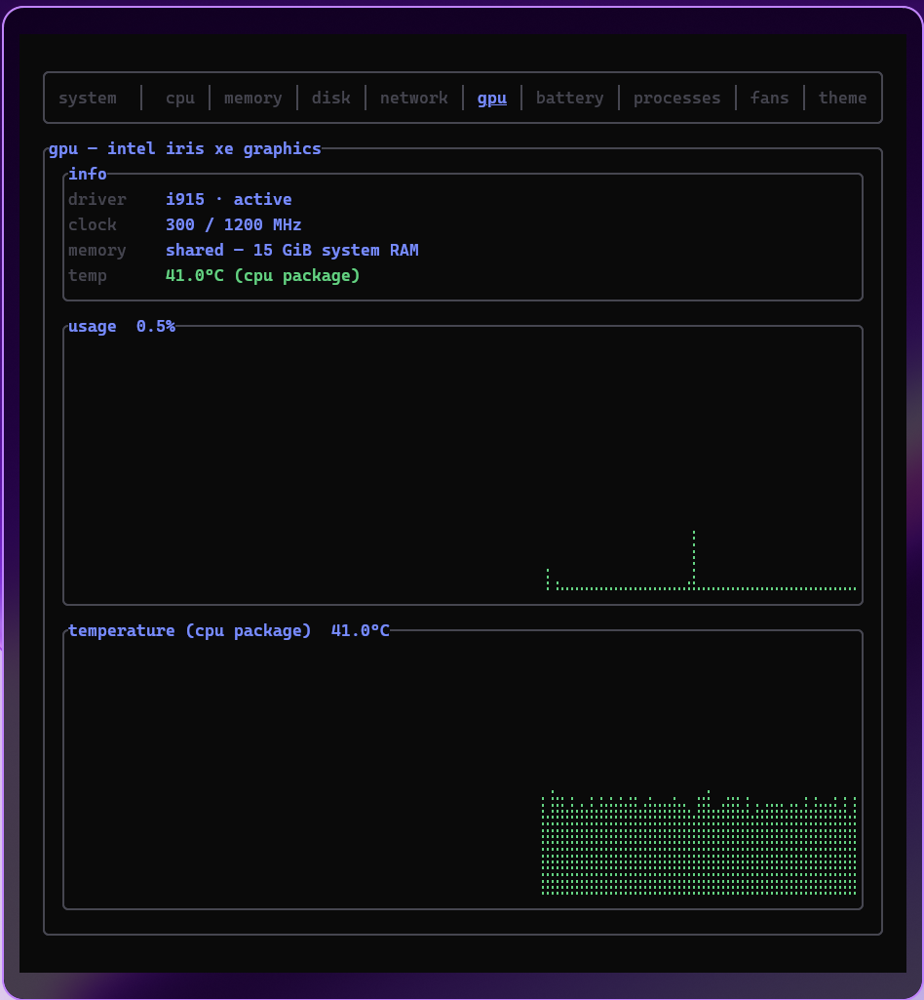
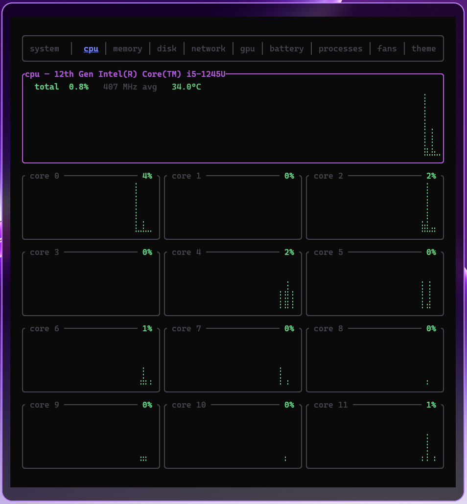
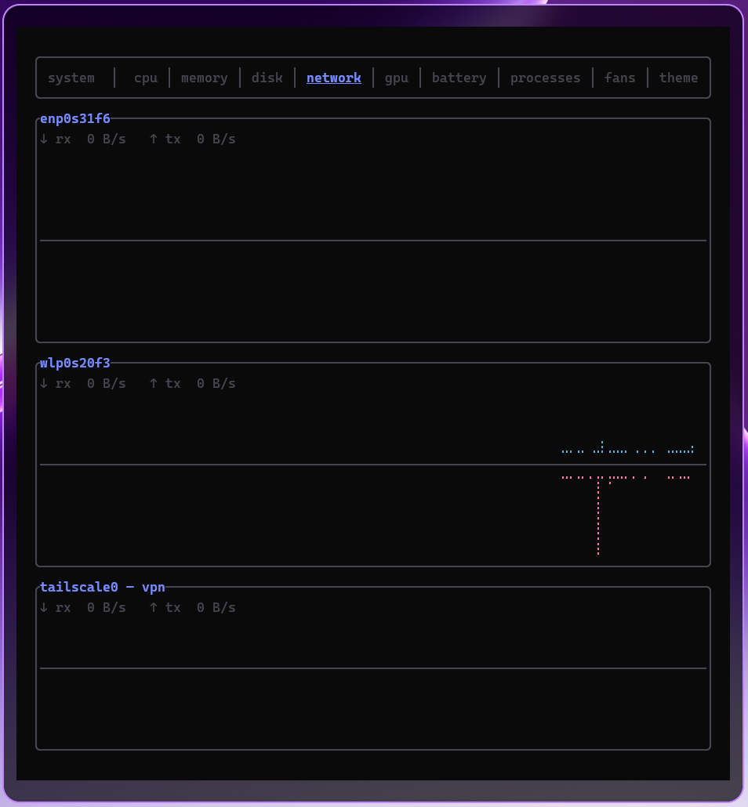
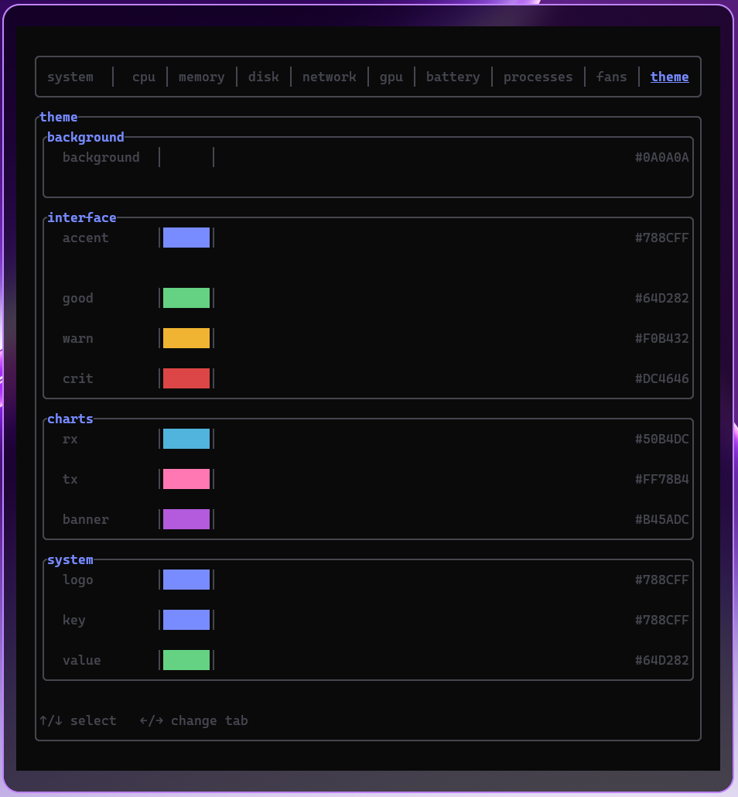

# RRM — Rust-based Resource Monitor

A fast, terminal-based system resource monitor for Linux, powered by `/proc` and `/sys`.

| gpu | cpu | network | theme |
|---|---|---|---|
|  |  |  |  |


## Install

```sh
cargo install --git https://github.com/fedeaielli/rrm
```

## Usage

```sh
rrm
```

## Tabs

`system` · `cpu` · `memory` · `disk` · `network` · `gpu` · `battery` · `processes` · `fans` · `theme`

The charts are drawn with braille glyphs, so the terminal font must cover the U+2800 block.

## Config

Configuration is optional. RRM reads it from `$XDG_CONFIG_HOME/rrm/config.toml`, falling back to `~/.config/rrm/config.toml`. Built-in defaults are used when no file exists.

| Option | Section | Type | Default | Description |
|---|---|---|---|---|
| `refresh_ms` | `display` | integer | `1000` | Refresh interval in milliseconds |
| `accent_color` | `display` | string | `"#00BFFF"` | Accent color as a `#RRGGBB` hex value |
| `sort_by` | `processes` | string | `"cpu"` | Process sort column: `"cpu"` or `"mem"` (in-app `s` cycles cpu/mem/read/write) |
| `accent`, `good`, `warn`, `crit`, `rx`, `tx`, `banner`, `background`, `logo`, `key`, `value` | `colors` | string | palette defaults | Palette overrides as `#RRGGBB` (or `transparent`); edited from the Theme tab |

Example:

```toml
[display]
refresh_ms = 1000
accent_color = "#00BFFF"

[processes]
sort_by = "cpu"

[colors]
accent = "#00BFFF"
good = "#64D282"
warn = "#F0B432"
crit = "#DC4646"
rx = "#50B4DC"
tx = "#B45ADC"
banner = "#B45ADC"
background = "#0A0A0A"
logo = "#00BFFF"
key = "#00BFFF"
value = "#64D282"
```

`background` also accepts `transparent` to let the terminal background show through.

## Keybindings

| Key | Action |
|-----|--------|
| ←/→ or Tab/Shift+Tab | Previous/Next tab |
| 1-9 | Jump to tab: 1 system, 2 cpu, 3 memory, 4 disk, 5 network, 6 gpu, 7 battery, 8 processes, 9 fans |
| PageDown | Open the theme tab (nothing selected), or focus the Processes table |
| ↑/↓ (Processes tab) | Move the selected process row |
| PgUp/PgDn (Processes tab) | Move ten rows |
| Home/End (Processes tab) | First / last process |
| ←/→ (Processes tab) | Scroll the process columns when a row is selected |
| Esc (Processes tab) | Leave the table |
| s (Processes tab) | Cycle sort: cpu → mem → read → write |
| Space (Processes tab) | Pause/resume the process list so rows stop moving |
| Enter (Processes tab) | Open the detail overlay for the selected process (cpu, ram, gpu, disk read/write); Esc closes it |
| ↑/↓ (Theme tab) | Select palette entry |
| ←/→ (Theme tab) | Change the selected color when an entry is selected, otherwise change tab |
| Enter (Theme tab) | Type a hex color |
| Esc (Theme tab) | Cancel the hex editor, then deselect and hand the arrows back to the tab bar |
| +/- | Increase/decrease refresh rate (100ms step) |
| q / Ctrl+C | Quit |

## Supported Metrics

- System overview: distro, host, kernel, uptime, packages, shell, desktop, terminal, CPU/GPU, memory, disk, load
- CPU usage (total and per-core), frequency, and temperature
- RAM and swap usage
- Disk I/O rates, partition space and zram usage
- Network RX/TX rates per interface, plus a dedicated block for Tailscale
- GPU usage, VRAM/shared memory, clock, driver and temperature (Intel/AMD via sysfs; Intel usage is estimated from RC6 residency)
- Battery charge, status, power draw and health
- All processes with CPU%, memory, disk read/write rates; scrollable table (disk I/O is owner-only, so other users' processes read 0)
- Fan speeds per sensor, scaled to the sensor's maximum rpm when reported
- Editable palette, saved to `config.toml`

## License

MIT
